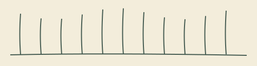
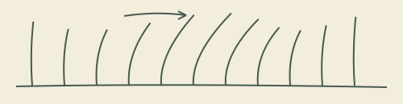
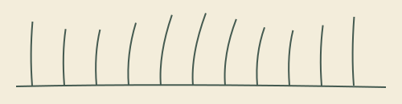

# 잔류 작업 노트

손이 떠난 뒤, 힘이 머물렀던 시간을 어떻게 볼 수 있을까?

## 1. 수심에 따라 해초 숲의 밀도와 색을 배치

힘이 지나간 자리를 보여주려면 먼저 가만히 있는 기준점이 필요했다. 뿌리는 고정하고 가까운 잎 몇 장에만 모래색을 주었다. 다음에는 잎끝만 움직여 뿌리와 대비시킨다.

[코드 변경 792a61a](../../commit/792a61a9396233bde243ce6a8f66660ff2d91ab7)

## 2. 물살을 질량에 따른 가속도와 속도로 적분

같은 물살이 닿아도 잎마다 반응이 다르면 좋겠다. 힘을 질량으로 나눈 뒤 속도와 변위에 차례로 더했다. 이 구조에는 뿌리 쪽으로 돌아갈 이유가 아직 없다.

[코드 변경 0f69fd5](../../commit/0f69fd556efbd4142e184706dbbd6eb4562dcbff)

## 3. 잎끝을 원위치로 당기는 복원력 추가

뿌리를 기억의 기준점으로 삼았다. 잎끝이 멀어질수록 더 세게 잡아당기면 돌아오는 길에 기준점을 한 번 넘어간다. 그 흔들림을 얼마나 오래 남길지가 다음 고민이다.

[코드 변경 584145a](../../commit/584145ae008ad8362d5271449f106c8c0e9f137a)

## 4. 속도 반대 방향의 저항으로 잔진동 감쇠

움직임을 갑자기 멈추면 손을 뗀 순간 기억도 끊긴다. 속도에 비례하는 저항을 더해 큰 흔들림부터 가라앉게 했다. 이제 관객이 직접 그 여운을 만들 차례다.

[코드 변경 ba79213](../../commit/ba79213fb7fe0c078ef5a6b92a934eef84b01029)

## 5. 손짓의 방향과 거리에 따라 물살 전파

숲 전체를 한꺼번에 밀면 손이 너무 커 보인다. 손끝에서 생긴 물살이 옆 잎에 늦게 닿도록 거리에 따른 지연을 두었다. 물살의 출발점이 어디였는지도 희미하게 남기고 싶다.

[코드 변경 7b765b7](../../commit/7b765b75effe7113ed21d19152d194c42e34cdca)

## 6. 수면에 번졌다 사라지는 파문 표시

수면은 먼저 잊고 숲은 늦게 잊는 장면을 택했다. 손의 위치에는 가는 타원을 놓고 잎보다 빨리 흐려지게 했다. 파문이 사라진 다음에도 잎끝을 보게 하고 싶다.

[코드 변경 ad95b48](../../commit/ad95b48515376c47993f7ccd4a89ec468302629c)

## 7. 같은 자리에서 반대 방향 물살을 보내는 조작 추가

같은 자리에서 반대 방향으로 두 번 밀면 앞선 움직임과 새 힘이 겹친다. 그 차이를 손의 이동 없이도 시험하도록 방향 버튼을 두었다. 한 번 누르고 기다릴 때와 연달아 누를 때의 리듬을 관객에게 맡긴다.

[코드 변경 1632e13](../../commit/1632e132ffa33b33c807da7130227172b452efab)
